# KidCare

Thành viên phát triển muốn chạy frontend với backend local hoặc import mock data vào PostgreSQL hãy xem [README.DEVELOPMENT.md](README.DEVELOPMENT.md).

## Yêu cầu

- Git, Node.js 20, npm và Docker với Docker Compose.

## Chạy lần đầu

```bash
git clone <repository-url>
cd KidCare
docker compose up -d db
```

Trong terminal backend:

```bash
cd backend
cp .env.example .env
npm ci
npm run migration:run
npm run start:dev
```

Trong terminal frontend:

```bash
cd frontend
npm ci
npm run dev
```

Mở <http://localhost:5173>, Swagger tại <http://localhost:3000/docs>, liveness tại <http://localhost:3000/health> và trạng thái DB tại <http://localhost:3000/health/ready>.

Trên Windows PowerShell, thay `cp backend/.env.example backend/.env` bằng `Copy-Item backend/.env.example backend/.env` nếu cần. `backend/.env` chỉ dành cho máy cá nhân, không commit.

## Cấu trúc

- `backend/`: NestJS API, TypeORM, cấu hình và migrations PostgreSQL.
- `frontend/`: React + Vite.
- `docker-compose.yml`: PostgreSQL 16 với volume bền vững `pgdata`.
- `.github/workflows/ci.yml`: kiểm tra backend, frontend và Docker trên pull request vào `main`.

## Luồng tổng quát frontend và backend

```mermaid
flowchart LR
  User[Người dùng trên trình duyệt] --> UI[React UI]
  UI -->|HTTP fetch /api/...| Proxy[Proxy theo môi trường]
  Proxy -->|Bỏ tiền tố /api, chuyển tiếp| API[NestJS API :3000]
  API --> Router[Controller của module]
  Router --> Service[Service xử lý nghiệp vụ]
  Service --> Repo[TypeORM Repository<Entity>]
  Repo --> DS[DataSource trong DatabaseModule]
  DS --> PG[(PostgreSQL)]
  PG --> DS --> Repo --> Service --> Router --> API --> Proxy --> UI
```



Proxy phụ thuộc cách chạy ứng dụng:

- **Development:** Vite ở `frontend/vite.config.ts` nhận request `/api/...`, bỏ `/api` rồi chuyển tới `http://localhost:3000`. Ví dụ `/api/health` được gửi tới backend dưới đường dẫn `/health`.
- **Frontend chạy bằng Nginx:** `frontend/nginx.conf` chuyển tiếp `/api/...` tới backend. Cấu hình hiện tại dùng `host.docker.internal:3000`.

Ở backend, `main.ts` khởi tạo NestJS và Swagger. `AppModule` kết nối các module. Controller nhận HTTP request và trả response; với chức năng nghiệp vụ, controller gọi service, service dùng repository để đọc/ghi entity. Repository dùng `DataSource` do `DatabaseModule` cung cấp để giao tiếp PostgreSQL. Response đi ngược lại qua các lớp đó dưới dạng HTTP/JSON.

### Luồng đang chạy trong repo

Trang chủ React hiện gọi `GET /api/health`. Vite hoặc Nginx chuyển request tới `GET /health` của `HealthController`, rồi controller trả JSON trạng thái backend. `GET /health/ready` gọi `DataSource.query('SELECT 1')` để kiểm tra kết nối database.

`User` entity và repository đã được đăng ký trong `UsersModule`, nhưng hiện chưa có `UsersController` hay `UsersService` sử dụng repository. Vì vậy luồng controller → service → repository trong sơ đồ mô tả cách các chức năng nghiệp vụ nên được nối khi triển khai; chưa phải luồng CRUD User đã có.

### Migration và khởi động

Migration là luồng riêng, không chạy theo từng request: cập nhật entity → tạo migration → xem lại SQL → chạy `migration:run` để cập nhật schema PostgreSQL. Khi backend khởi động, `DatabaseModule` khởi tạo `DataSource`; nếu PostgreSQL không truy cập được thì backend không khởi động thành công.

## Database và migrations

Docker Compose chỉ khởi động DB: `docker compose up -d db`. Dữ liệu nằm trong volume `pgdata` và tồn tại khi container bị dừng hoặc tạo lại. Xóa volume bằng `docker compose down -v` sẽ xóa dữ liệu.

Tạo migration sau khi cập nhật entity:

```bash
cd backend
npm run migration:generate
npm run migration:run
```

Migration `InitialSchema` là baseline không tạo bảng. Migration `Schema` tiếp theo tạo bảng `users` theo `User` entity. Luôn xem lại SQL migration được sinh trước khi chạy. Không bật `synchronize` trong ứng dụng.

### Import mock data Stage 2 vào PostgreSQL local

Để thử frontend với API backend, có thể import users, classes, children, teacher assignments và parent links từ mock database trình duyệt. Các dữ liệu mock cho attendance/health/activities/notifications chưa được import.

1. Chạy frontend một lần để khởi tạo mock data. Mở DevTools → Console và chạy:

   ```js
   copy(localStorage.getItem('kidcare.mockdb.v4'))
   ```

2. Tạo `mock-data.json` ở thư mục gốc repository, dán nội dung vừa copy vào. File này đã được `.gitignore` bỏ qua.
3. Đảm bảo PostgreSQL local đang chạy và xem các migration còn chờ:

   ```powershell
   cd backend
   npx typeorm-ts-node-commonjs -d src/database/data-source.ts migration:show
   ```

   Nếu cần, review rồi chạy migrations để tạo các bảng Stage 2.
4. Import từ thư mục `backend`:

   ```powershell
   npm run db:import-mock -- ../mock-data.json --confirm
   ```

Script chỉ nhập các bảng Stage 2, hash password mock bằng Argon2, và chạy trong một transaction. User trùng email và lớp trùng tên/năm học được cập nhật/ghép ID; các bản ghi khác được thêm theo ID mock. Đây là dữ liệu demo nên chỉ chạy trên database local/test. Tài khoản demo dùng mật khẩu `Password@123`.

Để frontend gọi backend, đặt `VITE_USE_MOCK=false` trong `frontend/.env.local`, khởi động lại Vite, rồi đăng nhập bằng user đã import. Các màn hình có endpoint backend Stage 2 mới hoạt động ở chế độ này; các chức năng Stage 3 trở đi vẫn cần mock hoặc API tương ứng.

Roadmap các stage 1–7 nằm tại [docs/roadmap/README.md](docs/roadmap/README.md). Đặc tả UC-01 đến UC-15 được lập chỉ mục tại [docs/01-requirements/use-cases/README.md](docs/01-requirements/use-cases/README.md).

ERD tổng thể của KidCare nằm tại [docs/02-design/erd.md](docs/02-design/erd.md); sơ đồ ghi rõ các giả định cần nhóm xác nhận trước khi tạo migration.

Class diagram tổng thể và class diagram theo từng UC được tích hợp tại [docs/02-design/class-diagram.md](docs/02-design/class-diagram.md).

Hợp đồng API OpenAPI theo roadmap (UC-01 đến UC-15) nằm tại [docs/02-design/openapi.yaml](docs/02-design/openapi.yaml). File này mô tả API mục tiêu; các endpoint nghiệp vụ sẽ được triển khai theo từng giai đoạn.

## Docker

```bash
docker build -t kidcare-backend ./backend
docker run --rm -p 3000:3000 --env-file backend/.env kidcare-backend
docker build -t kidcare-frontend ./frontend
docker run --rm -p 8080:80 kidcare-frontend
```

Frontend trong Nginx proxy `/api` tới backend ở `host.docker.internal:3000`. Backend chạy trên máy chủ Docker cần nghe cổng 3000. Trên Linux, thêm ánh xạ host gateway khi chạy frontend: `--add-host=host.docker.internal:host-gateway`.

## Kiểm tra

```bash
cd backend && npm run lint && npm test && npm run test:e2e && npm run build
cd frontend && npm run lint && npm test && npm run build
```

## Nhánh và commit

- Tạo nhánh từ `main` theo dạng `feature/ten-ngan` hoặc `fix/ten-ngan`.
- Mở pull request vào `main`; chờ CI xanh và review trước khi merge.
- Viết commit ngắn, nêu hành động, ví dụ `feat: add database readiness check` hoặc `fix: handle unavailable API`.

## Bảo vệ nhánh `main`

Trong GitHub: **Settings → Branches → Add branch protection rule**, chọn `main`, bật yêu cầu pull request và yêu cầu status checks `backend`, `frontend`, `docker`. Đây là thiết lập trên GitHub, cần quyền quản trị repository và không thể áp dụng từ các file trong repo.
