# KidCare — Class Diagrams

Các sơ đồ dưới đây được trích từ `06_So_Do_Use_Case.md`: sơ đồ tổng thể và sơ đồ lớp riêng của từng UC-01 đến UC-15. Đây là mô hình lớp nghiệp vụ, chưa phải cấu trúc TypeORM entity cuối cùng.

ERD mô tả bảng và khóa ngoại ở góc nhìn database tại [erd.md](erd.md). Class diagram mô tả lớp, thuộc tính, hành vi và quan hệ ở góc nhìn hướng đối tượng. Trước khi code, cần thống nhất các khác biệt về ID (`UUID` trong tài liệu nguồn, `int` trong ERD hiện tại), tên lớp và trạng thái.

## Class Diagram tổng thể

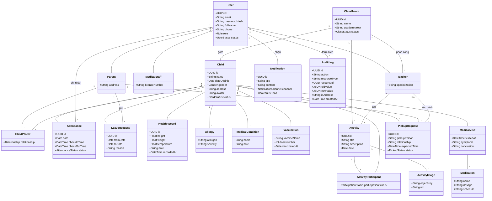

## UC-01 — Đăng nhập

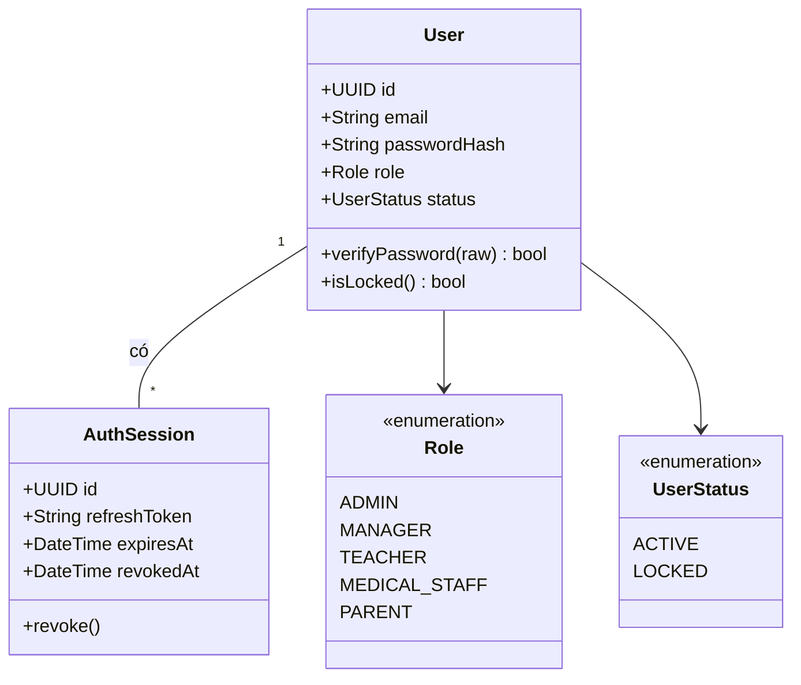

## UC-02 — Đăng ký tài khoản

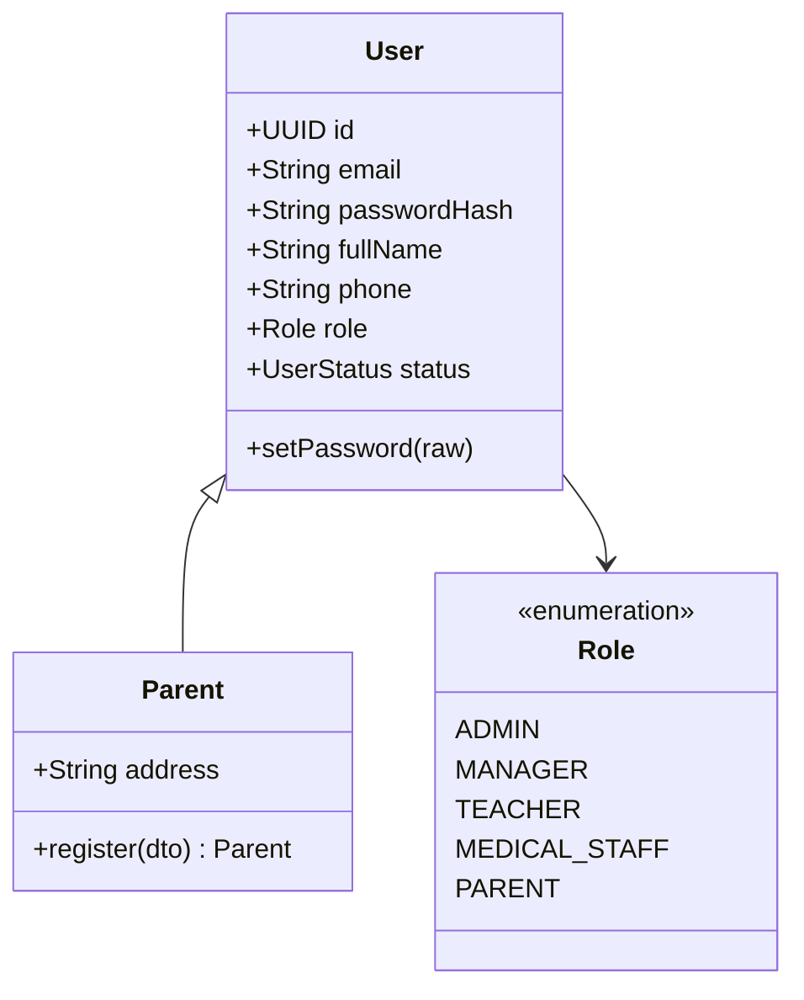

## UC-03 — Quản lý tài khoản người dùng

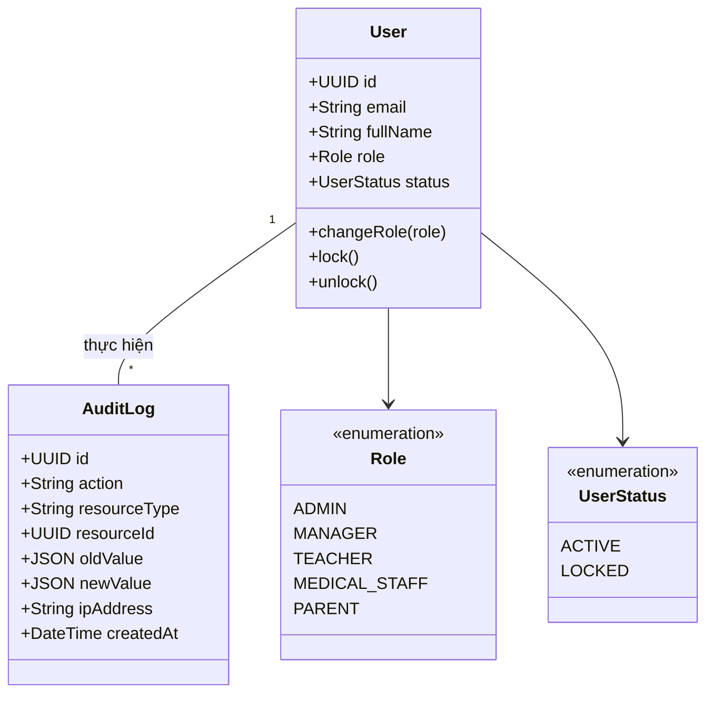

## UC-04 — Quản lý hồ sơ trẻ — tiếp nhận bé mới

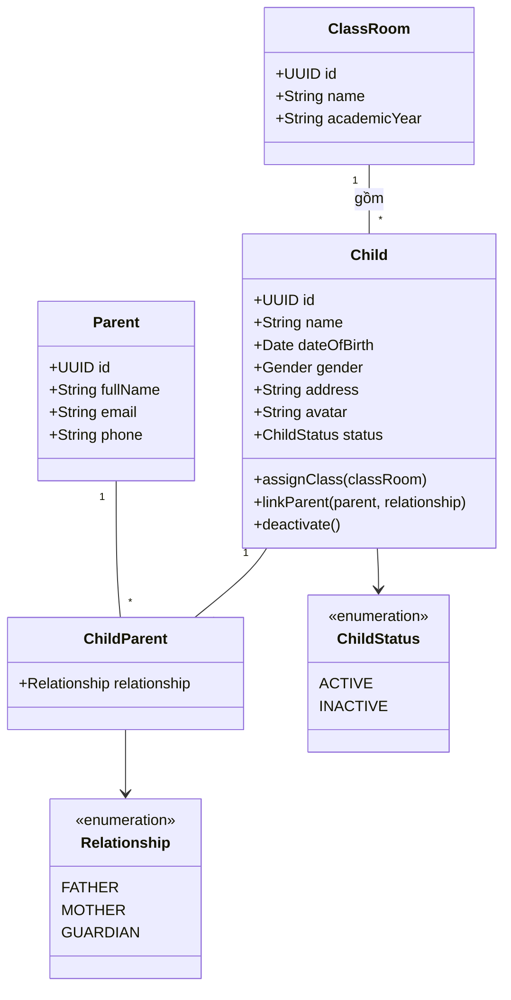

## UC-05 — Quản lý lớp học và phân công giáo viên

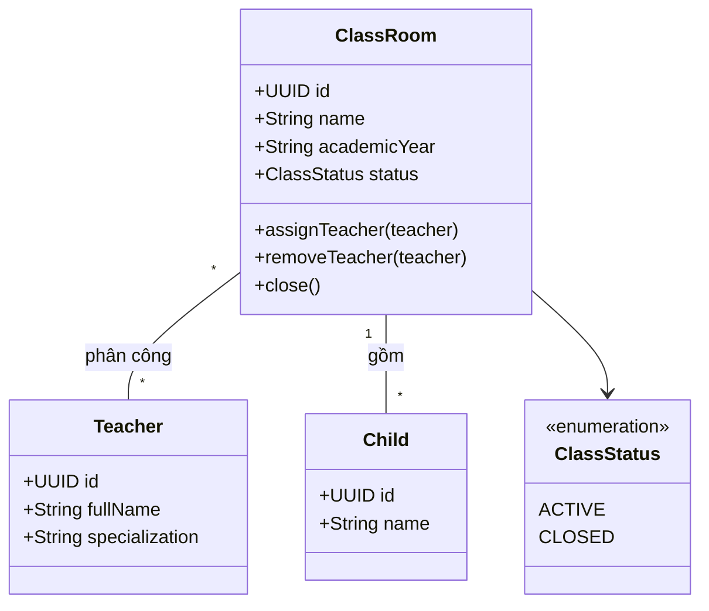

## UC-06 — Điểm danh trẻ

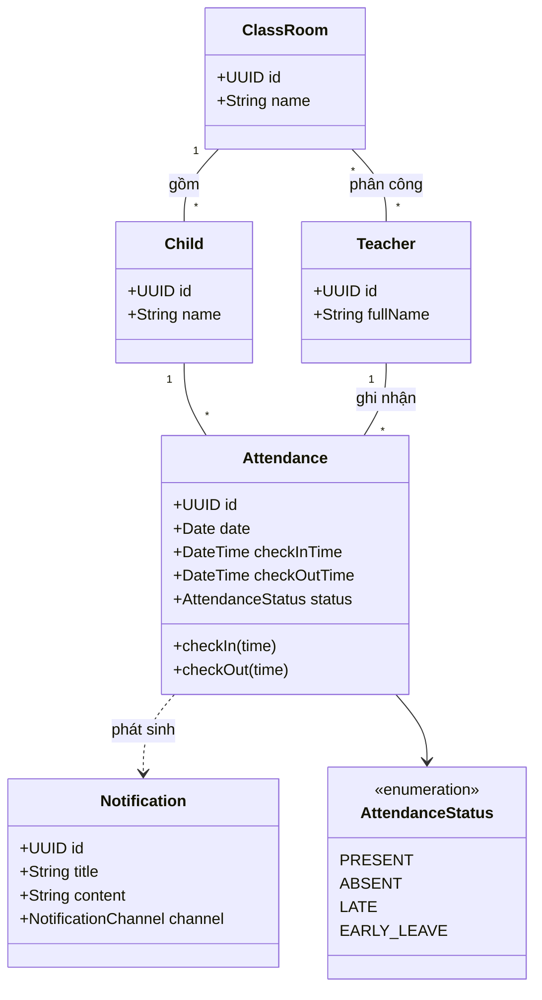

## UC-07 — Theo dõi tình hình của con

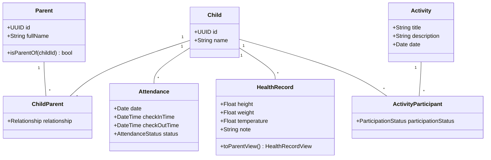

## UC-08 — Gửi yêu cầu nghỉ học

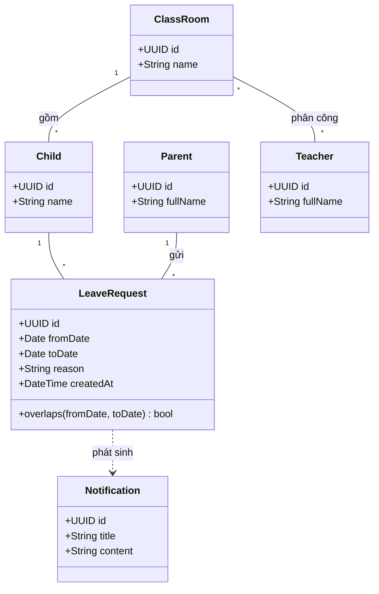

## UC-09 — Quản lý hồ sơ sức khỏe

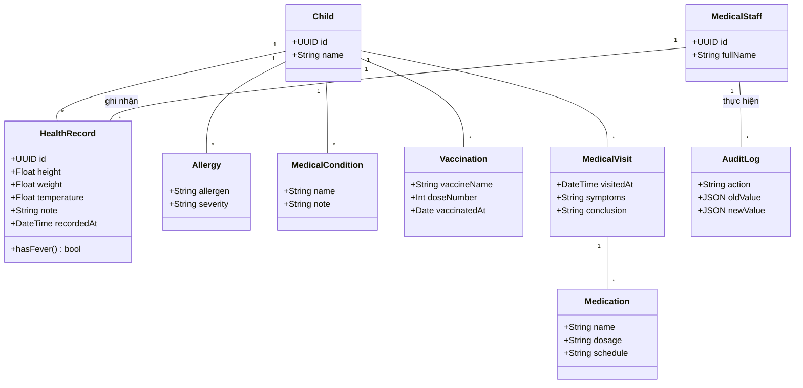

## UC-10 — Tạo hoạt động

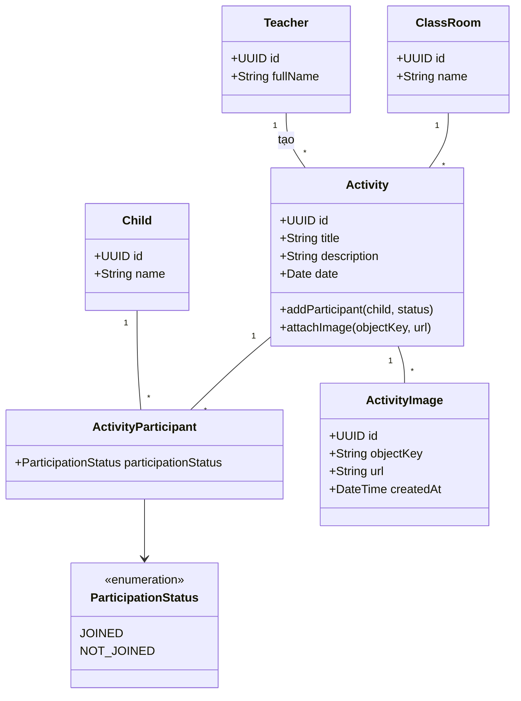

## UC-11 — Đăng ký người đón trẻ

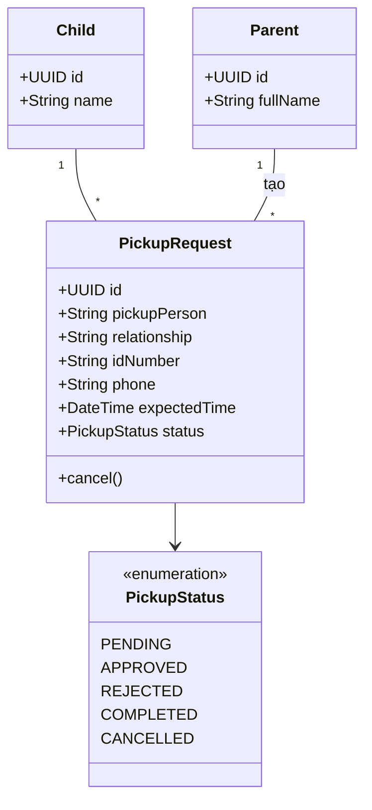

## UC-12 — Xác nhận đón trẻ

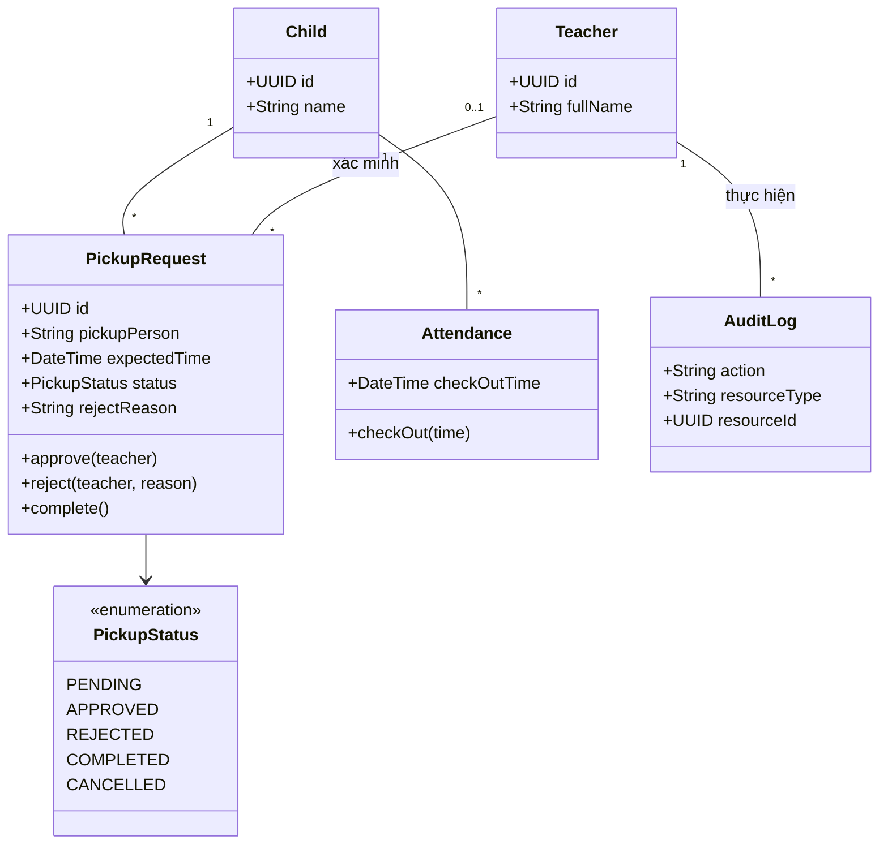

## UC-13 — Gửi thông báo cho phụ huynh

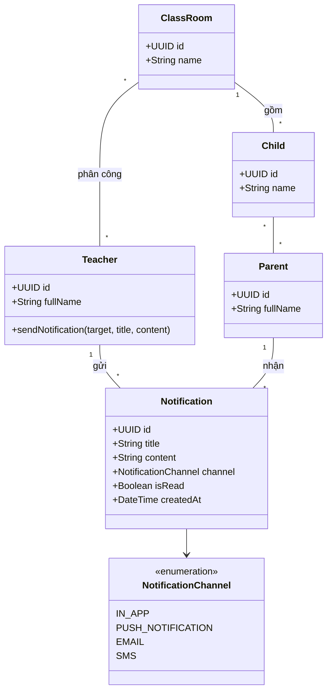

## UC-14 — Xem thông báo

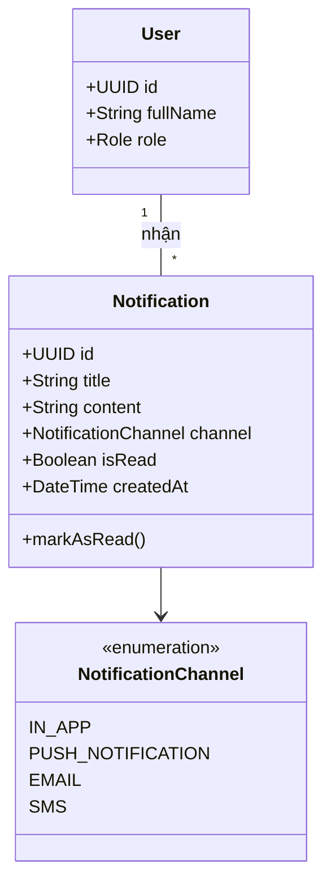

## UC-15 — Xem báo cáo

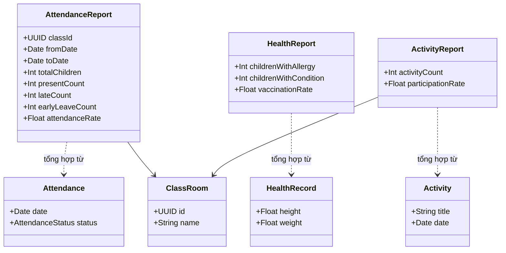

