# KidCare — Entity Relationship Diagram

ERD này ánh xạ các lớp, thuộc tính và quan hệ trong [class-diagram.md](class-diagram.md) sang mô hình quan hệ PostgreSQL. Các lớp kế thừa được biểu diễn bằng bảng profile có khóa chính đồng thời là khóa ngoại tới `USER`; quan hệ nhiều-nhiều dùng bảng nối.

```mermaid
erDiagram
    USER {
        UUID id PK
        string email UK
        string password_hash
        string full_name
        string phone
        string role
        string status
    }

    AUTH_SESSION {
        UUID id PK
        UUID user_id FK
        string refresh_token_hash
        datetime expires_at
        datetime revoked_at
    }

    PARENT {
        UUID user_id PK, FK
        string address
    }

    TEACHER {
        UUID user_id PK, FK
        string specialization
    }

    MEDICAL_STAFF {
        UUID user_id PK, FK
        string license_number
    }

    CHILD {
        UUID id PK
        UUID classroom_id FK
        string name
        date date_of_birth
        string gender
        string address
        string avatar
        string status
    }

    CHILD_PARENT {
        UUID child_id PK, FK
        UUID parent_user_id PK, FK
        string relationship
    }

    CLASSROOM {
        UUID id PK
        string name
        string academic_year
        string status
    }

    CLASS_TEACHER {
        UUID classroom_id PK, FK
        UUID teacher_user_id PK, FK
    }

    ATTENDANCE {
        UUID id PK
        UUID child_id FK
        UUID recorded_by_user_id FK
        date date
        datetime check_in_time
        datetime check_out_time
        string status
    }

    LEAVE_REQUEST {
        UUID id PK
        UUID child_id FK
        UUID parent_user_id FK
        date from_date
        date to_date
        string reason
        string status
    }

    HEALTH_RECORD {
        UUID id PK
        UUID child_id FK
        UUID recorded_by_staff_user_id FK
        float height
        float weight
        float temperature
        string note
        datetime recorded_at
    }

    ALLERGY {
        UUID id PK
        UUID child_id FK
        string allergen
        string severity
    }

    MEDICAL_CONDITION {
        UUID id PK
        UUID child_id FK
        string name
        string note
    }

    VACCINATION {
        UUID id PK
        UUID child_id FK
        string vaccine_name
        int dose_number
        date vaccinated_at
    }

    MEDICAL_VISIT {
        UUID id PK
        UUID child_id FK
        UUID recorded_by_staff_user_id FK
        datetime visited_at
        string symptoms
        string conclusion
    }

    MEDICATION {
        UUID id PK
        UUID medical_visit_id FK
        string name
        string dosage
        string schedule
    }

    ACTIVITY {
        UUID id PK
        UUID classroom_id FK
        UUID created_by_teacher_user_id FK
        string title
        string description
        date date
    }

    ACTIVITY_PARTICIPANT {
        UUID activity_id PK, FK
        UUID child_id PK, FK
        string participation_status
    }

    ACTIVITY_IMAGE {
        UUID id PK
        UUID activity_id FK
        string object_key
        string url
    }

    PICKUP_REQUEST {
        UUID id PK
        UUID child_id FK
        UUID parent_user_id FK
        UUID verified_by_teacher_user_id FK
        string pickup_person
        string relationship
        datetime expected_time
        string status
    }

    NOTIFICATION {
        UUID id PK
        UUID recipient_user_id FK
        UUID sender_user_id FK "nullable for system events"
        string title
        string content
        string channel
        boolean is_read
    }

    AUDIT_LOG {
        UUID id PK
        UUID actor_user_id FK
        string action
        string resource_type
        UUID resource_id
        json old_value
        json new_value
        string ip_address
        datetime created_at
    }

    USER ||--o| PARENT : profile
    USER ||--o| TEACHER : profile
    USER ||--o| MEDICAL_STAFF : profile
    USER ||--o{ AUTH_SESSION : has

    CLASSROOM ||--o{ CHILD : contains
    CLASSROOM ||--o{ CLASS_TEACHER : assigns
    TEACHER ||--o{ CLASS_TEACHER : teaches
    CHILD ||--o{ CHILD_PARENT : linked_to
    PARENT ||--o{ CHILD_PARENT : responsible_for

    CHILD ||--o{ ATTENDANCE : has
    USER ||--o{ ATTENDANCE : records
    CHILD ||--o{ LEAVE_REQUEST : has
    PARENT ||--o{ LEAVE_REQUEST : submits

    CHILD ||--o{ HEALTH_RECORD : has
    MEDICAL_STAFF ||--o{ HEALTH_RECORD : records
    CHILD ||--o{ ALLERGY : has
    CHILD ||--o{ MEDICAL_CONDITION : has
    CHILD ||--o{ VACCINATION : receives
    CHILD ||--o{ MEDICAL_VISIT : has
    MEDICAL_STAFF ||--o{ MEDICAL_VISIT : records
    MEDICAL_VISIT ||--o{ MEDICATION : prescribes

    CLASSROOM ||--o{ ACTIVITY : hosts
    TEACHER ||--o{ ACTIVITY : creates
    ACTIVITY ||--o{ ACTIVITY_PARTICIPANT : includes
    CHILD ||--o{ ACTIVITY_PARTICIPANT : participates
    ACTIVITY ||--o{ ACTIVITY_IMAGE : has

    CHILD ||--o{ PICKUP_REQUEST : has
    PARENT ||--o{ PICKUP_REQUEST : requests
    TEACHER o|--o{ PICKUP_REQUEST : verifies

    USER ||--o{ NOTIFICATION : receives
    TEACHER o|--o{ NOTIFICATION : sends
    USER ||--o{ AUDIT_LOG : performs
```

## Cách ERD ánh xạ class diagram

- `User <|-- Parent/Teacher/MedicalStaff` trong class diagram được biểu diễn bằng ba profile table: `PARENT.user_id`, `TEACHER.user_id`, `MEDICAL_STAFF.user_id` vừa là PK vừa là FK tới `USER.id`.
- Quan hệ nhiều-nhiều `ClassRoom`–`Teacher`, `Child`–`Parent` và `Activity`–`Child` cần các bảng nối `CLASS_TEACHER`, `CHILD_PARENT`, `ACTIVITY_PARTICIPANT` trong database.
- `LeaveRequest`, `Allergy`, `MedicalCondition`, `Medication` và `AuthSession` được thêm để bao phủ các lớp trong class diagram theo UC.
- `sender_user_id` trong `NOTIFICATION` phản ánh UC-13 (giáo viên gửi); người nhận là `recipient_user_id` theo UC-14.
- `AUTH_SESSION.refresh_token_hash` lưu hash của refresh token, không lưu token nguyên bản. Tên `AuthSession` khớp class diagram; cột hash áp dụng yêu cầu bảo mật.
- Các lớp enum như `Role`, `UserStatus`, `Gender`, `AttendanceStatus`, `PickupStatus`, `NotificationChannel` và `ParticipationStatus` được lưu thành cột enum/string trong các bảng, không cần bảng riêng ở MVP.
- `AttendanceReport`, `HealthReport`, `ActivityReport` trong UC-15 là dữ liệu tổng hợp trả về từ truy vấn, không phải bản ghi nghiệp vụ cần lưu lâu dài; vì vậy ERD không tạo bảng báo cáo riêng.
- `resource_type` + `resource_id` trong `AUDIT_LOG` là tham chiếu đa hình tới nhiều loại đối tượng nên `resource_id` không thể có một FK duy nhất.

## Ràng buộc đề xuất

- `USER.email` là duy nhất.
- `CLASSROOM(name, academic_year)` là duy nhất.
- `CLASS_TEACHER(classroom_id, teacher_user_id)` là duy nhất.
- `CHILD_PARENT(child_id, parent_user_id)` là duy nhất.
- `ATTENDANCE(child_id, date)` là duy nhất để mỗi trẻ chỉ có một bản ghi mỗi ngày.
- `ACTIVITY_PARTICIPANT(activity_id, child_id)` là duy nhất.
- Mọi khóa ngoại tới profile phải tham chiếu đúng role: ví dụ `CLASS_TEACHER.teacher_user_id` phải là `USER` có profile `TEACHER` và đang hoạt động. Ràng buộc role này thường cần kiểm tra trong service/transaction, ngoài FK thông thường.

## Phạm vi theo increment

- **Increment 1:** `USER`, `AUTH_SESSION`.
- **Increment 2:** profile user, `CLASSROOM`, `CLASS_TEACHER`, `CHILD`, `CHILD_PARENT`, `AUDIT_LOG`.
- **Increment 3:** `ATTENDANCE`, `LEAVE_REQUEST`.
- **Increment 4:** `HEALTH_RECORD`, `ALLERGY`, `MEDICAL_CONDITION`, `VACCINATION`, `MEDICAL_VISIT`, `MEDICATION`.
- **Increment 5:** `ACTIVITY`, `ACTIVITY_PARTICIPANT`, `ACTIVITY_IMAGE`, `NOTIFICATION`.
- **Pickup (tùy chọn):** `PICKUP_REQUEST`.

## Lưu ý trước khi triển khai

ERD nay dùng `UUID` như class diagram nguồn. Backend hiện có thể đang dùng `SERIAL/int` cho `User`; nhóm cần thống nhất kiểu ID trước khi tạo entity/migration tiếp theo. Nếu migration đã áp dụng trên database dùng chung, không sửa migration cũ để đổi kiểu khóa; tạo migration mới và xem xét tác động tới các FK hiện có.

Các trường `status` của leave request, recipient/sender của notification và một số FK ghi nhận là dữ liệu cần thiết để hỗ trợ luồng use case, dù class diagram tổng quát không liệt kê hết. Hãy giữ class diagram, UC và ERD đồng bộ khi nhóm chốt thiết kế.

## ERD rút gọn theo use case

Mỗi sơ đồ dưới đây chỉ hiển thị các bảng liên quan trực tiếp tới UC đó; vì vậy entity dùng chung sẽ lặp lại giữa các sơ đồ. Các cột không liên quan tới luồng được lược bớt. Khóa ngoại và quan hệ nhiều-nhiều được thể hiện như trong ERD tổng thể.

### UC-01 — Đăng nhập

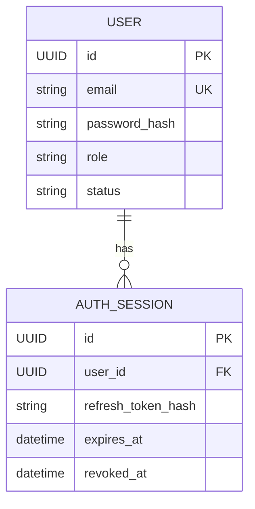

### UC-02 — Đăng ký tài khoản

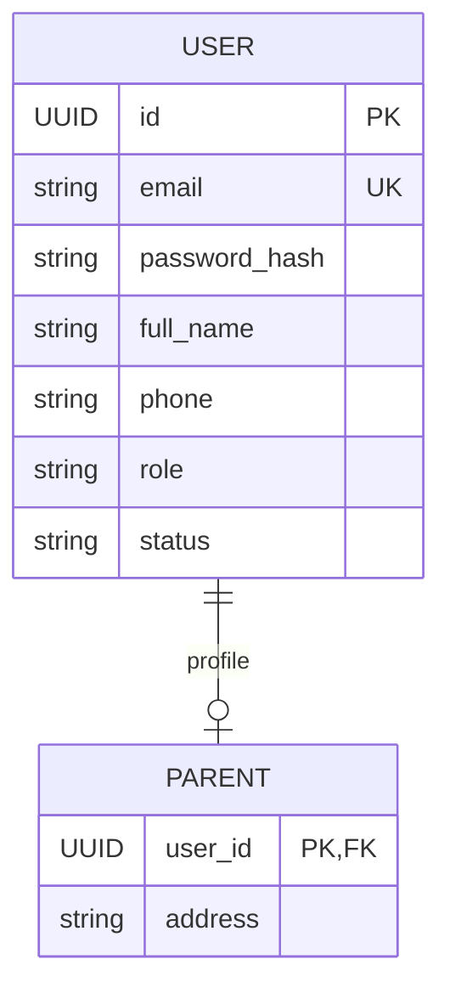

### UC-03 — Quản lý tài khoản người dùng

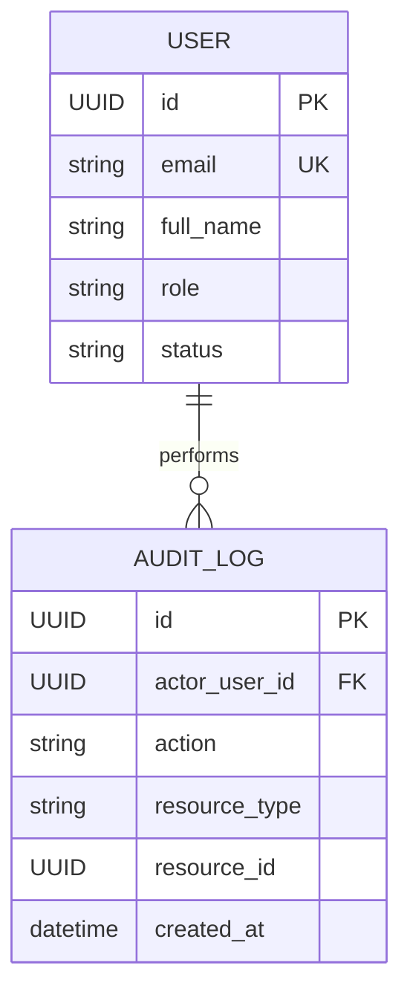

`resource_id` là định danh đối tượng bị thay đổi, không phải FK cố định vì audit log có thể ghi nhiều loại đối tượng.

### UC-04 — Quản lý hồ sơ trẻ

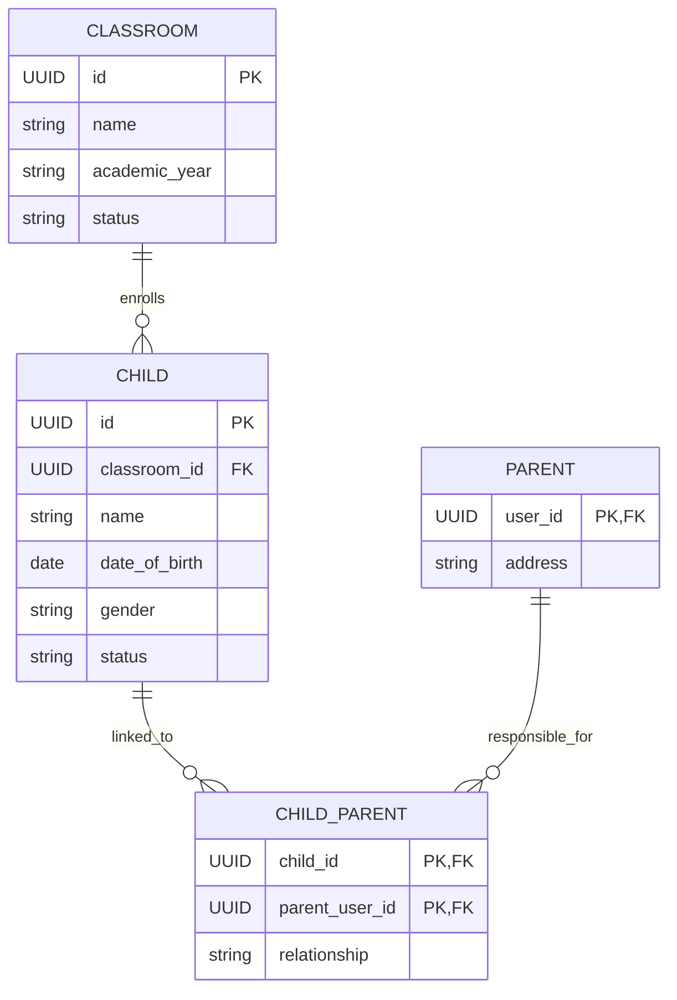

### UC-05 — Quản lý lớp và phân công giáo viên

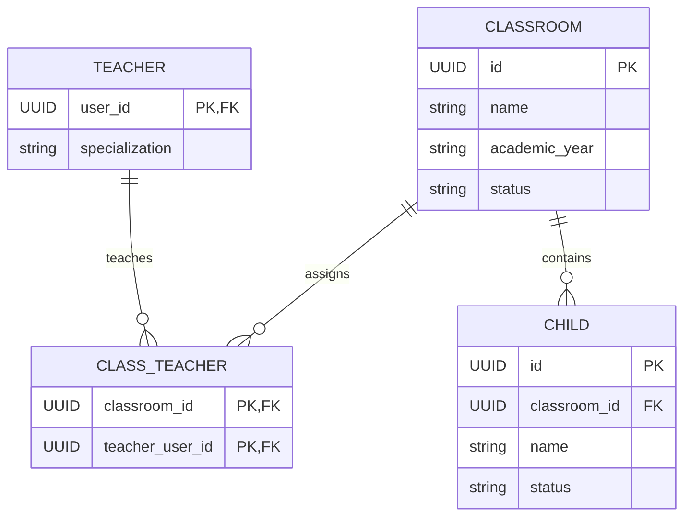

### UC-06 — Điểm danh trẻ

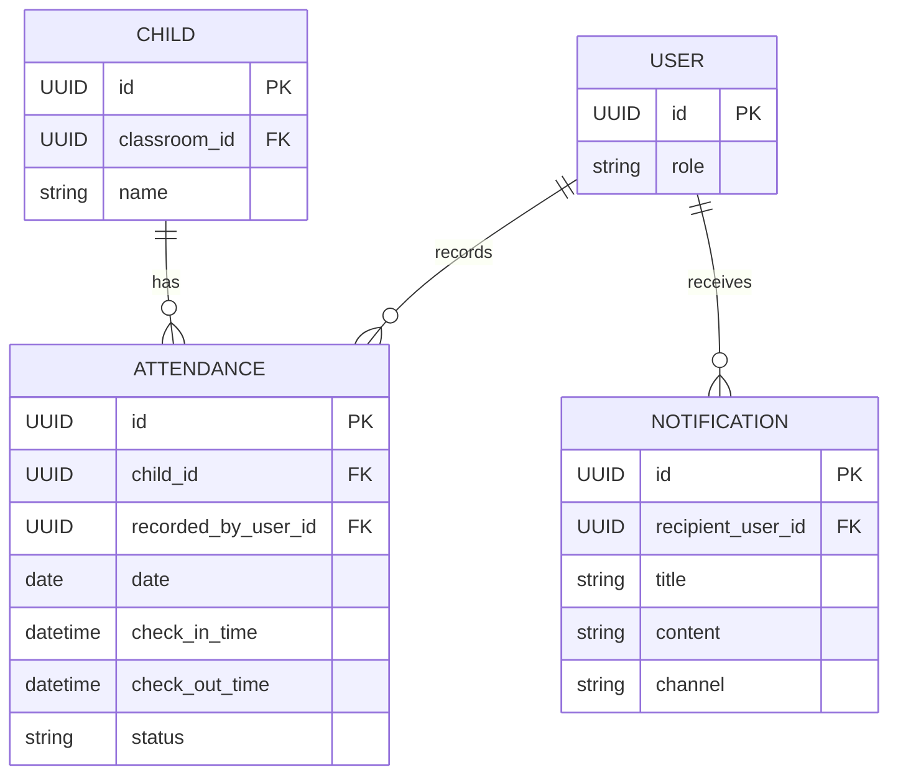

Thông báo được phát sinh sau sự kiện điểm danh; `NOTIFICATION` không có FK trực tiếp tới `ATTENDANCE` vì nguồn được nhận diện bằng loại/ID sự kiện nếu cần.

### UC-07 — Theo dõi tình hình của con

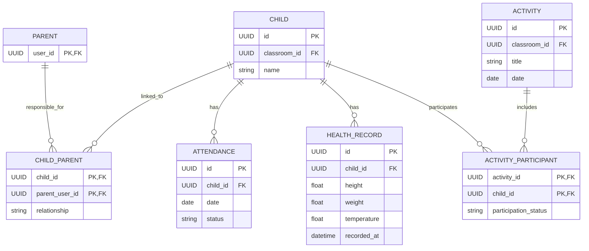

### UC-08 — Gửi yêu cầu nghỉ học

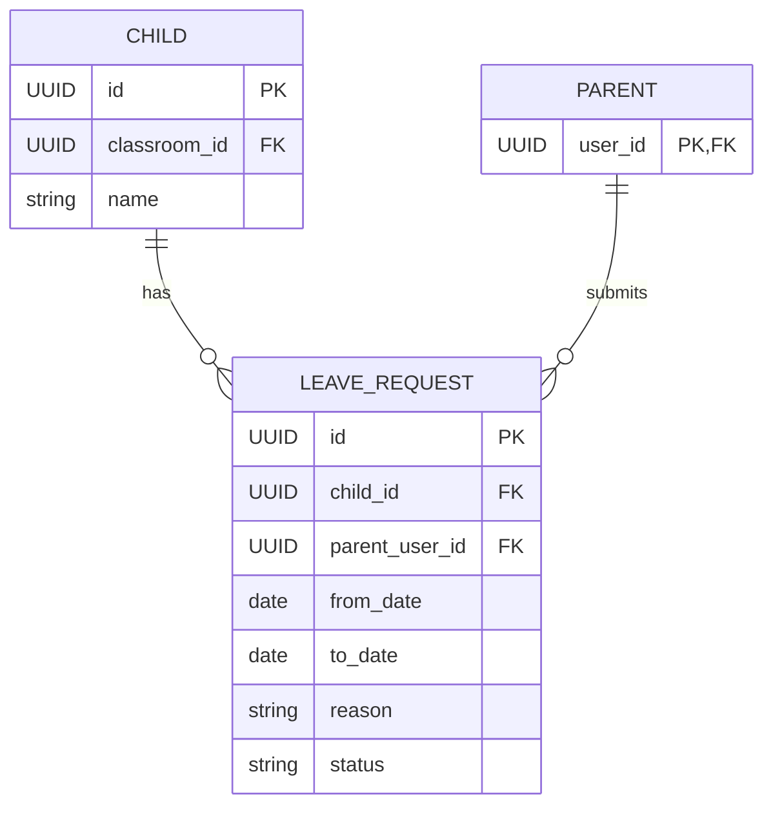

### UC-09 — Quản lý hồ sơ sức khỏe

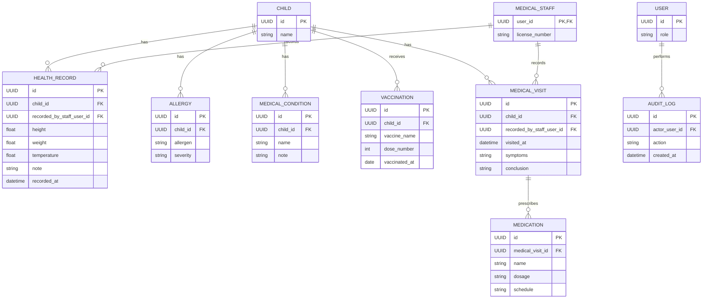

### UC-10 — Tạo hoạt động

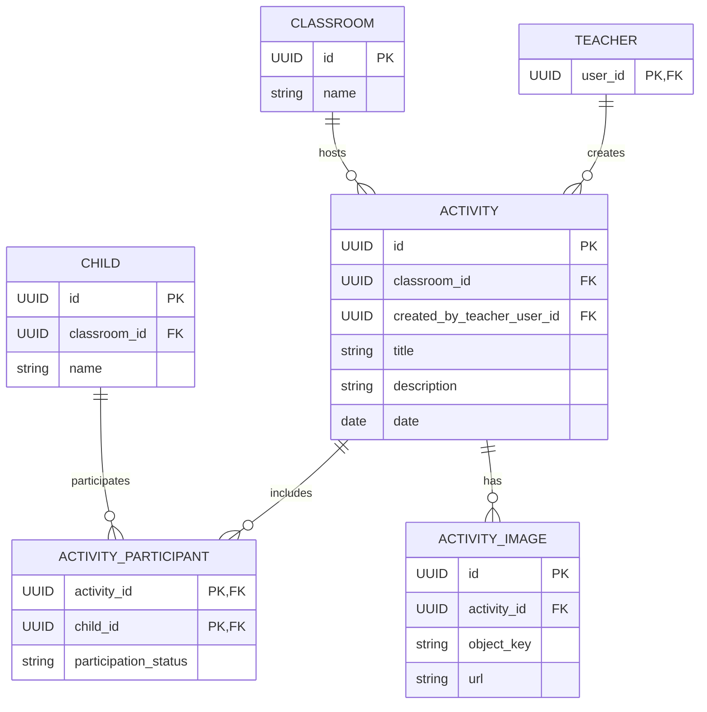

### UC-11 — Đăng ký người đón trẻ

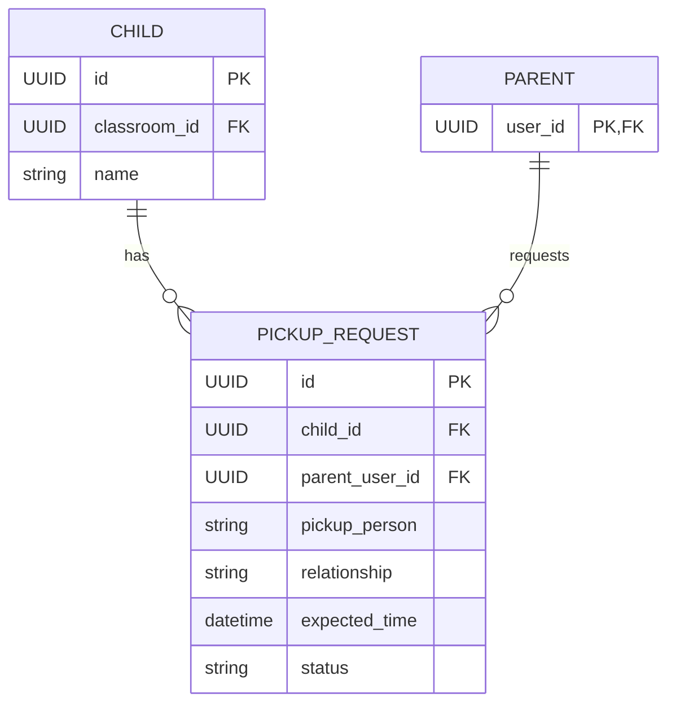

### UC-12 — Xác nhận đón trẻ

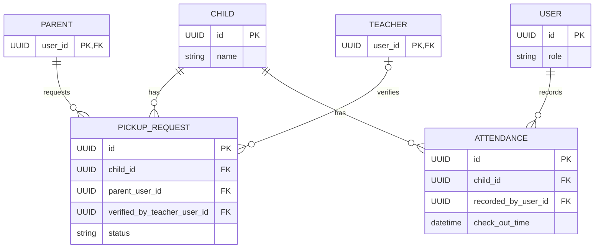

### UC-13 — Gửi thông báo cho phụ huynh

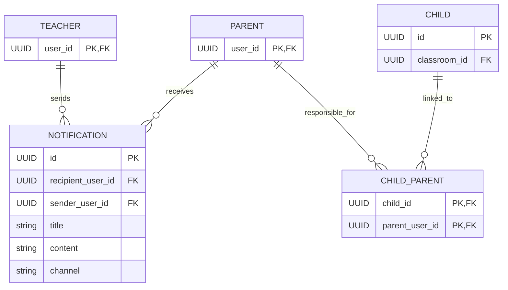

### UC-14 — Xem thông báo

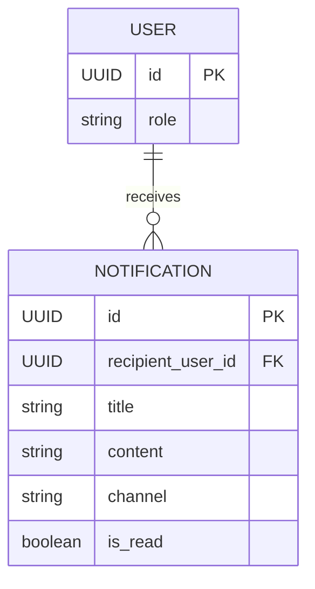

### UC-15 — Xem báo cáo

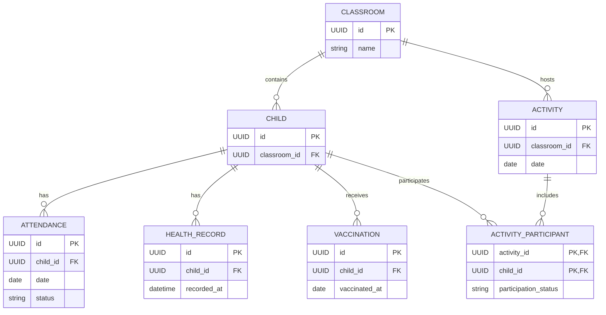

UC-15 tổng hợp dữ liệu từ các bảng nguồn theo lớp và khoảng thời gian. Các lớp `AttendanceReport`, `HealthReport`, `ActivityReport` là kết quả tính toán, không phải bảng lưu riêng.
